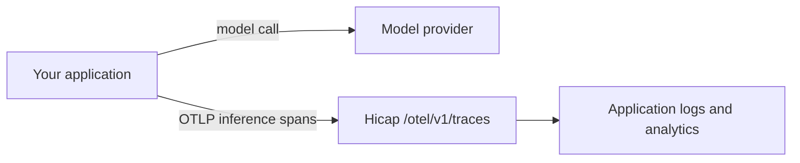

An **external application** tracks AI usage from systems that don't send requests through the Hicap AI Gateway. That includes your own provider accounts, self-hosted models, and other gateways. You report that usage with OpenTelemetry. Hicap then shows it in the application's logs and analytics, next to the rest of your usage.

External usage is **reporting only**. It never charges your Hicap wallet, and it is never billed as Hicap spend.

## What is OpenTelemetry?

[OpenTelemetry](https://opentelemetry.io/docs/what-is-opentelemetry/) (OTel) is an open, vendor-neutral standard for collecting telemetry such as traces, metrics, and logs from software. Most languages have an official OpenTelemetry SDK, and many AI frameworks and SDKs can emit OpenTelemetry traces.

In a trace, each unit of work is a **span**. When your code calls a model, the call is recorded as an **inference span**. OpenTelemetry's [GenAI semantic conventions](https://opentelemetry.io/docs/specs/semconv/gen-ai/) define standard attribute names for these spans, such as the model, the provider, and token counts. Hicap reads those attributes to build your usage analytics.

An **exporter** sends spans from your process to a collector over OTLP, the OpenTelemetry protocol. Here, Hicap is the collector.

## How it works



Your model requests keep going straight to your provider. Hicap only receives the usage metadata in each inference span.

## Set up an external application

<Steps>
  <Step title="Create the external application">
    In the [Hicap Platform](https://platform.hicap.ai/), open the application selector and choose **New External Application**. Give it a name of up to 40 characters.
  </Step>
  <Step title="Copy the analytics key">
    Hicap creates an **analytics key** for the application and shows it once. Copy it and store it as a secret.

    An analytics key can only report usage. It can't make inference requests, and your inference keys can't report external usage.
  </Step>
  <Step title="Point your OpenTelemetry exporter at Hicap">
    Configure your OTLP/HTTP trace exporter with the Hicap endpoint, and send the analytics key in the `api-key` header. See [Configure your exporter](#configure-your-exporter).
  </Step>
  <Step title="Check your analytics">
    Make a few model calls. Requests and token counts appear in the application's logs and analytics once Hicap processes them.
  </Step>
</Steps>

## Configure your exporter

| Setting | Value |
| --- | --- |
| Traces endpoint | `https://api.hicap.ai/otel/v1/traces` |
| Protocol | OTLP/HTTP with protobuf (`application/x-protobuf`) or JSON (`application/json`) |
| Compression | None or `gzip` |
| Authentication | `api-key: <your analytics key>` header |

Most OpenTelemetry SDKs read the standard exporter environment variables:

```bash
OTEL_EXPORTER_OTLP_TRACES_ENDPOINT=https://api.hicap.ai/otel/v1/traces
OTEL_EXPORTER_OTLP_TRACES_PROTOCOL=http/protobuf
OTEL_EXPORTER_OTLP_TRACES_HEADERS=api-key=YOUR_ANALYTICS_KEY
OTEL_SERVICE_NAME=support-assistant
```

<Note>
  If you use the generic `OTEL_EXPORTER_OTLP_ENDPOINT` instead, set it to `https://api.hicap.ai/otel`. The SDK appends `/v1/traces` for you. Don't put the full traces path in the generic setting. These rules come from the [OpenTelemetry exporter specification](https://opentelemetry.io/docs/specs/otel/protocol/exporter/#endpoint-urls-for-otlphttp).
</Note>

Hicap accepts traces only. gRPC, OTLP metrics, and OTLP logs are not supported.

### Example: Python

This example records one chat call as an inference span and exports it to Hicap.

```python
from opentelemetry import trace
from opentelemetry.exporter.otlp.proto.http.trace_exporter import OTLPSpanExporter
from opentelemetry.sdk.resources import Resource
from opentelemetry.sdk.trace import TracerProvider
from opentelemetry.sdk.trace.export import BatchSpanProcessor

provider = TracerProvider(resource=Resource.create({"service.name": "support-assistant"}))
provider.add_span_processor(
    BatchSpanProcessor(
        OTLPSpanExporter(
            endpoint="https://api.hicap.ai/otel/v1/traces",
            headers={"api-key": "YOUR_ANALYTICS_KEY"},
        )
    )
)
trace.set_tracer_provider(provider)
tracer = trace.get_tracer("support-assistant")

with tracer.start_as_current_span("chat gpt-4o", kind=trace.SpanKind.CLIENT) as span:
    response = client.chat.completions.create(model="gpt-4o", messages=messages)
    span.set_attribute("gen_ai.operation.name", "chat")
    span.set_attribute("gen_ai.provider.name", "openai")
    span.set_attribute("gen_ai.request.model", "gpt-4o")
    span.set_attribute("gen_ai.response.model", response.model)
    span.set_attribute("gen_ai.usage.input_tokens", response.usage.prompt_tokens)
    span.set_attribute("gen_ai.usage.output_tokens", response.usage.completion_tokens)
```

If you already use instrumentation that follows the OpenTelemetry GenAI semantic conventions, you usually only need to point its exporter at Hicap.

### Example: send a test span with curl

```bash
curl https://api.hicap.ai/otel/v1/traces \
  -H "api-key: $HICAP_ANALYTICS_KEY" \
  -H "Content-Type: application/json" \
  -d '{
    "resourceSpans": [{
      "resource": {
        "attributes": [{ "key": "service.name", "value": { "stringValue": "support-assistant" } }]
      },
      "scopeSpans": [{
        "spans": [{
          "traceId": "5b8efff798038103d269b633813fc60c",
          "spanId": "eee19b7ec3c1b174",
          "name": "chat gpt-4o",
          "kind": 3,
          "startTimeUnixNano": "1767225600000000000",
          "endTimeUnixNano": "1767225601200000000",
          "attributes": [
            { "key": "gen_ai.operation.name", "value": { "stringValue": "chat" } },
            { "key": "gen_ai.provider.name", "value": { "stringValue": "openai" } },
            { "key": "gen_ai.request.model", "value": { "stringValue": "gpt-4o" } },
            { "key": "gen_ai.usage.input_tokens", "value": { "intValue": "1200" } },
            { "key": "gen_ai.usage.output_tokens", "value": { "intValue": "300" } }
          ],
          "status": { "code": 1 }
        }]
      }]
    }]
  }'
```

A successful request returns `{}`. Use a new `traceId` and `spanId` for each test, because Hicap records each span only once.

## Span requirements

Hicap records a span as usage only when it is an inference span:

- `gen_ai.operation.name` is `chat`, `text_completion`, `generate_content`, or `embeddings`.
- The span kind is `CLIENT` or `INTERNAL`, or it isn't set. Server, producer, and consumer spans are rejected. So are parent spans for agents or workflows.
- The end time is after the start time, the span lasts no longer than 7 days, and it doesn't end more than 5 minutes in the future.

### Attributes Hicap reads

| Attribute | Where | Used for |
| --- | --- | --- |
| `gen_ai.operation.name` | Span | Required. The type of inference call. |
| `gen_ai.response.model`, falling back to `gen_ai.request.model` | Span | The model shown in analytics. |
| `gen_ai.provider.name`, falling back to `gen_ai.system` | Span | The provider shown in analytics. |
| `gen_ai.usage.input_tokens` | Span | Total input tokens, **including** cached tokens. |
| `gen_ai.usage.output_tokens` | Span | Output tokens. |
| `gen_ai.usage.cache_read.input_tokens` | Span | Input tokens read from the provider's prompt cache. |
| `gen_ai.usage.cache_creation.input_tokens` | Span | Input tokens written to the provider's prompt cache. |
| `service.name` | Resource | The harness or client that made the call. |

Model, provider, and `service.name` values can be up to 128 characters. Longer or empty values show as `unknown`. Values with control characters are rejected. Token counts must be non-negative whole numbers, and cache tokens can't be more than total input tokens.

### Optional Hicap attributes

| Attribute | Type | Meaning |
| --- | --- | --- |
| `hicap.usage.source` | string | Set to `estimated` when your token counts are estimates rather than counts your provider reported. |
| `hicap.usage.cost_usd` | double | Your cost for the call in US dollars. Must be zero or more. |
| `hicap.usage.cost_source` | string | `reported` if the cost came from your provider, otherwise `estimated`. |

Costs you report are shown as external estimates, separate from billed Hicap spend.

### What Hicap stores

Hicap keeps only the usage metadata described above, plus the trace ID, span ID, timing, and status. It doesn't store prompts, responses, span events, links, or any other attributes.

## How usage appears

- **Requests and token counts** appear in the application's logs and analytics, with the model, provider, and harness.
- **Missing counts stay unknown.** If a span has no token counts, Hicap counts the request but marks its tokens as unknown, instead of recording zero.
- **Errors are tracked.** Spans with an error status are recorded as failed requests.
- **No wallet charge.** External usage never debits your wallet and isn't affected by your balance.

## Delivery and retries

- **Export every inference span.** Don't sample inference spans, or your usage totals will be incomplete. Export each span after its final token counts are known.
- **Each span is recorded once.** Hicap deduplicates on trace ID and span ID within an application. If a span is sent again, the first copy wins. A retried model call that uses tokens again needs its own span.
- **Partial success.** If some spans in a batch are invalid, Hicap accepts the valid ones. It returns `200` with an OTLP `partialSuccess` that lists how many spans were rejected. Don't retry that batch.
- **Retry `429` and `503`** with backoff, and honor the `Retry-After` header. Standard OTLP exporters already do this.

### Limits

| Limit | Value |
| --- | --- |
| Request body | 1 MiB, before and after gzip decompression |
| Spans per request | 256 |
| Attributes per span or resource | 128 |
| Requests | 120 per minute, 20,000 per day |
| Spans | 10,000 per minute, 1,000,000 per day |
| Data | 16 MiB per minute, 512 MiB per day |

Contact [support@hicap.ai](mailto:support@hicap.ai) if you need higher limits.

### Errors

| Status | Meaning | What to do |
| --- | --- | --- |
| `400` | The body isn't a valid OTLP traces request, is too large, or the URL has query parameters. | Fix the request. Don't retry it unchanged. |
| `401` / `403` | The `api-key` is missing or invalid, it isn't an analytics key, or the external application is inactive. | Check the key and the application. |
| `415` | Unsupported content type or encoding. | Use `application/x-protobuf` or `application/json`, with no compression or `gzip`. |
| `429` | You hit a limit. | Retry after the `Retry-After` delay. |
| `503` | Ingestion is temporarily unavailable. | Retry with backoff. |

Error bodies are OTLP `Status` messages in the same encoding as your request.
