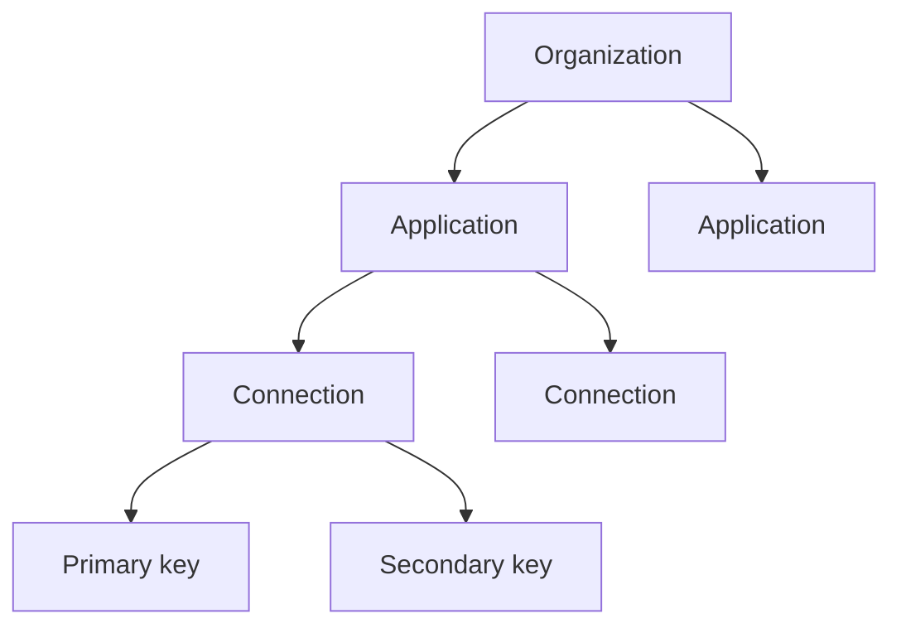

An **Organization** contains **Applications**. An Application has **Connections**, and each Connection has a **primary** and a **secondary key**. Connections provide the account context for requests, while request tags add details such as feature or workflow.

## The hierarchy

### Organization

An **Organization** is your company's account on the Hicap AI Gateway. It contains your **users** and the Applications they work on, and it is the top level that all usage and spend ultimately roll up to.

Organizations are also where **teams** live. A team is a group of users inside your Organization — it describes who people are and what they can reach, not how a request is labeled.

### Application

An **Application** is a product, service, or workload that consumes AI. Applications are the rollup point for Keys: every Key ultimately reports its usage into the Application it belongs to, which makes the Application the natural unit to plan, budget, and report on.

Group your work into Applications the way you think about it internally, so reporting matches how you already plan.

### Connection

A **Connection** belongs to an Application and provides the context for its primary and secondary keys. An Application can have multiple Connections, for example to separate environments or workloads. Review the settings available for each Connection in your deployment; budget, model, routing, and reporting behavior can depend on its configuration.

### Keys

A **Key** is the credential your client actually sends. Every Connection carries two Keys — a **primary** and a **secondary** — and either one is equally valid for making requests.

The two keys support rotation: move clients to one key, verify the old key is no longer in use, and then regenerate the old key. Plan and verify the transition for all clients before revoking or regenerating a key.

Because a Key is issued under a Connection, every request made with it already carries the Connection and the Application it belongs to.

## How the hierarchy supports reporting

The key identifies the structural context of a request. Descriptive attribution requires request tags:

- **Review shared usage.** Use the Connection and Application context to review usage and spend for the relevant Organization.
- **Rotate credentials.** Move clients between a Connection's primary and secondary keys without creating a new Application. Verify all clients before regenerating a key.

## When to add an Application or Connection

<AccordionGroup>
  <Accordion title="When to add another Application">
    Add an Application when you're building a distinct product or workload you want to plan, budget, and report on separately. Because Applications are where Keys roll up, this is the boundary that shapes your reporting.
  </Accordion>
  <Accordion title="When to add another Connection">
    Add a Connection when part of an Application needs a separate credential or reporting context, such as a production environment and an experiment. Each Connection has a primary and secondary key. Check the settings available in your deployment before relying on separate budgets or routing.
  </Accordion>
  <Accordion title="When to use the secondary Key">
    Use the secondary key as part of a rotation: move clients onto it, confirm nothing is still calling with the primary, then regenerate the primary. Verify your deployment's access and rotation procedures before making the change.
  </Accordion>
</AccordionGroup>

## Structural vs. descriptive attribution

Organizations, Applications, Connections, and Keys give you **structural** attribution: it comes from which Key you used, requires nothing at call time, and is fixed by how you provisioned things.

For **descriptive** attribution — labels you choose per request and can reinterpret afterwards — see [Tags, Dimensions & Segments](/concepts/tags-dimensions-segments). Both roll up into the same spend reporting; they answer different questions.
