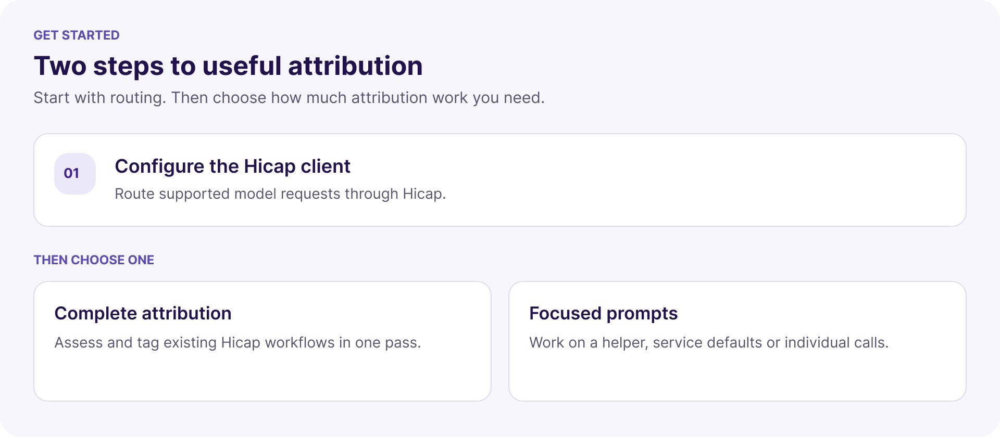
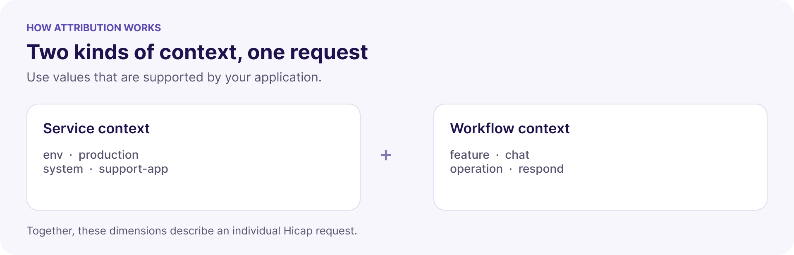

Use these prompts with a coding agent that can read and edit your application. They help you route model requests through Hicap and describe what each request is doing. You can review the full instructions before running them and review the resulting changes as you would any other code change.

## Choose your path



**New to Hicap?** Start with client setup, then run the complete attribution prompt. **Already using Hicap?** Start with attribution, or use a focused prompt to address a particular gap. The focused prompts are an alternative way to build attribution, not additional required steps after a complete pass. Base dimensions requires an existing tagging helper; client setup alone does not create one. You can select an individual focused prompt when its prerequisites are already met.

| Prompt | Use it when | What the agent works on |
| --- | --- | --- |
| [Configure the Hicap client](#1-configure-the-client) | Model calls are not yet routed through Hicap | Client configuration, supported inference routes and routing checks |
| [Set up attribution](#2-set-up-attribution) | You want a complete pass across existing Hicap requests | A workflow inventory, shared attribution and caller-specific dimensions |
| [Tagging helper](#focused-prompts) | You need a reusable way to build and attach tags | Existing Hicap tag handling, merge behavior and request isolation |
| [Base dimensions](#focused-prompts) | Service-wide values need to be configured | Evidence-backed deployment, system and domain defaults using an existing helper |
| [Per-call features](#focused-prompts) | Different workflows or steps need distinct attribution | Caller-specific feature, operation, role and other applicable values |

## What happens when a prompt runs

Each prompt asks the agent to follow the same general process, with a different scope:

The agent inspects the code, maps requests and gaps, makes scoped changes, checks outgoing requests, and reports what remains unverified.

The agent works within your repository and may update code, tests, configuration examples and documentation. The exact edits depend on your application. Review the proposed changes and the report before deploying. The prompts use mocked provider responses for their checks; a passing mock does not prove live provider access, output quality or recorded Hicap attribution. They do not deploy your app or generate paid traffic without approval.

## Before you start

- Make a Hicap key available to the application server, typically as `HICAP_API_KEY`. Create and manage keys in the [Hicap Platform](https://platform.hicap.ai/); do not paste a key into the prompt, source code or report.
- Make your repository available to your coding agent and provide any approved service or deployment names. Existing conventions are preferred over invented defaults.
- Use an SDK or adapter that supports the API workflows and Hicap capabilities your application needs. Decide which workflows should use Hicap. The agent inventories API families and reports compatibility it cannot establish; an OpenAI-compatible client alone does not establish support for every endpoint or model.
- For the attribution prompts, configure the Hicap client first. Read [Tags, Dimensions & Segments](/concepts/tags-dimensions-segments) for how request dimensions work.

## 1. Configure the client

Use this when you want to route supported application inference through Hicap. The agent traces model callers and configures an appropriate client or adapter, preserves existing attribution, and checks the outgoing destination and authentication. It reports unverified or unsupported workflows. This prompt does **not** design a new tagging strategy.

```text wrap title="Client setup"
Read https://docs.hicap.ai/onboarding-prompts/configure-client and help me set this up.
```

[Review the full client setup prompt](/onboarding-prompts/configure-client).

## 2. Set up attribution

After Hicap routing is configured, use this for a complete attribution pass. The agent inventories Hicap-bound workflows, assesses six starter dimensions—Env, Feature, Operation, System, Agent and Domain—and adds source-backed values where they apply. It checks the tags on outgoing requests and reports gaps. Attribution uses existing Hicap routes and does not change your provider, models or fallback routing. Other provider paths are inventoried separately; if no Hicap client exists, it reports that prerequisite and points to client setup.

```text wrap title="Complete attribution"
Read https://docs.hicap.ai/onboarding-prompts/attribution and help me set this up.
```

[Review the full attribution prompt](/onboarding-prompts/attribution).

### How dimensions describe a request

Service-wide values and caller-specific values work together. The following example illustrates possible labels; choose values supported by your own code and conventions.



For example, the same service might use `operation: rewrite-question` for one model call and `operation: answer` for another. Agent or Domain values should be included only when supported by the application's context. A valid header alone does not establish that every applicable workflow or dimension is covered.

## Focused prompts

Use these instead of the complete attribution pass when you want to work on a narrower part of an existing Hicap integration. Each prompt still asks the agent to inspect the affected call paths and report what was verified.

<AccordionGroup>
  <Accordion title="Tagging helper: build and attach tags">
    The agent reviews existing tags and merge rules, then adds or repairs a shared way to attach them to Hicap-bound requests. It checks caller isolation and keeps Hicap headers away from other providers. It does not change routing.

    ```text wrap title="Tagging helper"
    Read https://docs.hicap.ai/onboarding-prompts/tagging-helper and help me set this up.
    ```

    [Review the full tagging helper prompt](/onboarding-prompts/tagging-helper).
  </Accordion>
  <Accordion title="Base dimensions: configure service context">
    Given an existing tagging helper, the agent reviews approved service and deployment conventions and configures applicable service-wide defaults. It reports unresolved values instead of inventing them; workflow-specific values remain with their callers.

    ```text wrap title="Base dimensions"
    Read https://docs.hicap.ai/onboarding-prompts/base-dimensions and help me set this up.
    ```

    [Review the full base dimensions prompt](/onboarding-prompts/base-dimensions).
  </Accordion>
  <Accordion title="Per-call features: distinguish workflows">
    The agent traces individual model workflows and attaches applicable feature, operation and named role values at the caller. It checks shared clients, retries and queues where they exist, without switching providers.

    ```text wrap title="Per-call features"
    Read https://docs.hicap.ai/onboarding-prompts/per-call-features and help me set this up.
    ```

    [Review the full per-call features prompt](/onboarding-prompts/per-call-features).
  </Accordion>
</AccordionGroup>

## Review the result

The agent should leave a report in your repository's `.hicap` directory, preserve earlier reports, and identify the inspected workflows, changes, checks and gaps. Use it alongside the code diff:

1. **Check scope.** Confirm which model paths route to Hicap, which remain elsewhere, and which could not be verified. If there are no model calls, a prepared client does not establish integration coverage.
2. **Check dimensions.** Review observed and suggested values for all six starter dimensions. Confirm each applicable value comes from your application's context; omit values that are unresolved or do not apply.
3. **Check the evidence.** Confirm each Hicap-bound model request sends one `x-hicap-tags` header containing a JSON object of string values. Separate configured source, mocked outgoing requests, live responses and recorded attribution. Check that concurrent calls, retries and existing queues are covered where relevant. Do not include secrets or personal identifiers in ordinary tags.
4. **Verify fresh traffic.** After your deployment and any approved live tests, select the right application, environment and time window in Hicap. Compare fresh recorded usage with the expected workflows and dimensions; older requests retain their original tags. An **Unattributed Traffic** group can indicate missing expected dimensions. See [Tags, Dimensions & Segments](/concepts/tags-dimensions-segments).

<CardGroup cols={2}>
  <Card title="Developer Quickstart" icon="rocket" href="/quickstart">
    Configure a client and make a first request.
  </Card>
  <Card title="Tags, Dimensions & Segments" icon="tags" href="/concepts/tags-dimensions-segments">
    Learn how request dimensions and reporting segments work.
  </Card>
</CardGroup>
