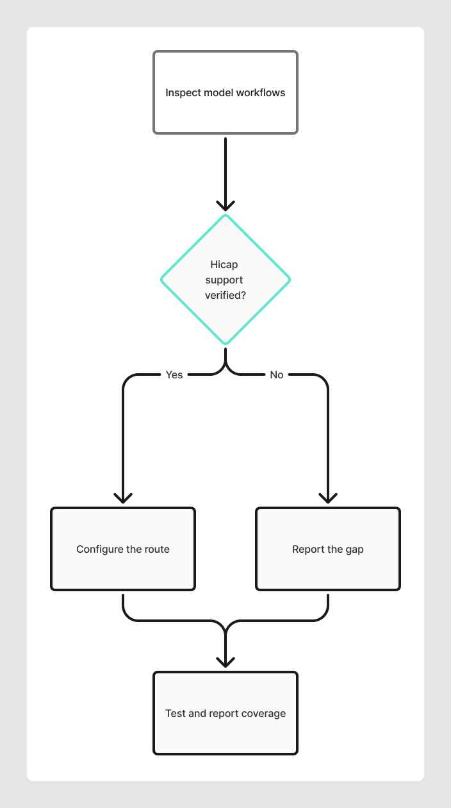

Use this prompt when your application does not yet have a Hicap route. The agent traces model call sites, configures an appropriate client or adapter, checks outgoing routing, and reports unsupported or unverified paths.

Client setup preserves existing attribution and does not create a tagging strategy. Once the client is configured, use the [complete attribution prompt](/onboarding-prompts/attribution) or the focused prompts.

## Decision flow

This diagram summarizes the intended decisions in the prompt. The complete instruction below is the source of truth.



## Full prompt

The block below is the complete instruction for your coding agent. Review it before use, then review the agent's changes and verification report. For the overall workflow, see [Set up Hicap with a coding agent](/concepts/implement-attribution-with-an-agent).

````text wrap title="Implementation prompt"
Configure or repair this application's Hicap model client. Read repository
instructions and trace all existing model transports and callers before editing.
Migrate the application's in-scope model inference calls to Hicap. Reuse an
OpenAI-compatible client when it can target Hicap; otherwise configure an
appropriate compatible adapter for the existing SDK. Preserve application
features, streaming and unrelated traffic, not the old inference provider as an
implicit fallback. Add only a placeholder HICAP_API_KEY to the example environment
file. If no model calls exist, report zero; do not add AI behavior.

Hicap contract:
- State whether the implementation uses the native OpenAI SDK or an existing SDK
  with an OpenAI-compatible adapter. Compatibility does not mean SDK replacement.
- Use an OpenAI-compatible client or SDK adapter with https://api.hicap.ai/v1.
  Read HICAP_API_KEY on the server and send it in the api-key header. Never expose,
  log or commit credentials. Do not reroute unrelated HTTP calls.
- Trace every in-scope inference caller through its final transport, including
  default and title models, tools, background work, alternate models and retries.
  Route each supported path to Hicap by default. Do not add an opt-in switch,
  conditional provider fallback or silent direct-provider route that makes a
  migrated workflow bypass Hicap. Preserve an explicitly requested non-Hicap
  route only when the user or existing product requirements authorize it, and
  document and test it as an exception. Do not change unrelated HTTP requests.
- Inventory API families separately: chat completions, responses, embeddings,
  images, moderation, Assistants, batch, files and fine-tuning where present.
  Record endpoint, model, required behavior, compatibility evidence and outcome:
  migrate, explicitly authorized exception, or blocked/unverified. An
  OpenAI-compatible client does not prove support for every API family. Leaving
  a path unchanged is not an authorized exception; report incomplete migration
  until compatibility or the exception is established.
- Gateway-specific SDKs, model identifiers, provider options and catalog or
  capability discovery are not automatically portable. Verify Hicap model IDs,
  account access and required API capabilities; use a compatible SDK adapter
  and preserve tool use, streaming and structured output where supported.
  Assert structured-output schemas, streaming flags and tool definitions in the
  outgoing body; a canned successful response cannot establish preservation.
  Check the emitted structured-output mode and schema constraints, not just the
  presence of a schema. SDK defaults can change: strict JSON Schema and tool
  calling have different requirements, especially for optional fields. Preserve
  the application's output contract; do not silently drop fields to make a
  request pass. With authorized live testing, check provider acceptance;
  otherwise mark live schema compatibility unverified. Canned-success mocks
  prove serialization/parsing, not upstream acceptance.
  Record SDK capability warnings as gaps. Never relabel one model as another.
  If a required model or behavior is not available, surface the failure and report
  the exact affected workflow rather than silently routing it elsewhere or
  claiming a complete migration.
  Check default chat, title generation, tool and background models separately;
  identify unavailable selections and user-visible effects. Do not present a
  model or capability as verified solely because it appears in a catalog. Make
  any new model option explicit and do not silently change the selected model.
- Inventory model-catalog, model-availability and capability-discovery requests
  separately from inference; replace stale gateway-specific discovery when needed
  for the new route, or explicitly report it as a remaining dependency.
- Preserve existing attribution headers and their merge behavior. Do not invent
  dimensions, add a tagging helper, or change the application's attribution
  strategy as part of client setup. Report attribution gaps for the separate
  attribution task. Never expose, log or commit credentials, prompts or
  personal data when recording evidence.

Verification and completion:
- Scale checks to the application's actual architecture. Do not add production
  workflows, roles or queues just to satisfy a test. Mark genuinely absent paths
  not applicable; distinguish them from present but untested paths.
- Keep mock tests fail-closed: block unexpected network calls and await all
  concurrent work and retries before removing mocks, including on failures.

- Bind every captured request to its originating application workflow using a
  distinct synthetic input or an independently observed request body. Derive
  expected routing, model and existing attribution from that workflow's behavior,
  not from the emitted headers or the implementation's configuration registry.
  Check each request and retry individually. Add a phase-appropriate negative
  control: an incorrect destination/model or loss of an existing header must fail
  the test. Swap caller settings only when distinguishable callers exist; a
  single caller can use one incorrect expected setting. Restore correct code
  afterwards. Never introduce attribution to satisfy a client-setup test.
  Synthetic correlation markers stay in test inputs, never production tags.
- Invoke the actual application entrypoint where feasible. A model-factory test
  does not verify its caller. Name any mocked database/auth boundary and any
  unexercised orchestration. Separately report output quality: canned responses
  prove transport and parsing only, not useful model answers.
- Use mocked provider responses. Capture the FINAL outgoing HTTP headers and URL
  from real application functions, not just the tag builder. Assert the Hicap
  host and path and api-key, and assert no in-scope inference
  request reaches the old inference gateway or a direct provider except
  documented authorized routes. Report any retained discovery dependency
  separately. Assert existing attribution headers remain unchanged where
  present; redact credentials and sensitive values from captured evidence.
  Distinguish a configured client and mocked success from confirmed live model
  access. If live access is untested or fails, record the affected paths and do
  not claim the application is ready.
- Check representative normal workflows and alternate modes, scripts/jobs and
  fallbacks. Reconcile every discovered model path with a routing assertion,
  an explicitly authorized exception, or an untested/deferred gap.
  Exercise concurrent callers and a failed attempt followed by a successful retry
  where those behaviors exist; do not invent them for coverage.
  Test enqueue/consume context when queues exist. Run relevant existing checks.
- Separate source changes, mock-tested behavior, deployed revision and fresh
  observed traffic. Historical requests retain their old tags. For live follow-up,
  use a time window after deployment, the correct application/environment, and
  relevant request scope. Do not claim live routing works from mocks or old traffic.
  Do not deploy, change dashboard rules or generate paid traffic without approval.

Update README as needed and save a concise coverage/test report under the
application repository's .hicap directory, preserving existing reports with a
timestamped sibling. Include source revision, a per-workflow route and model
inventory, redacted destinations and headers, any old-gateway discovery calls,
existing attribution and routing gaps, and post-deployment verification steps.
Show the exact report path when done.

Current-state report requirements:
- For client setup, report existing attribution and gaps only; defer new dimension
  recommendations and tagging implementation to the attribution task.
- Lead with the current source revision and prompt revision (include dirty-state
  or content hashes), selected models, SDK/adapter, destination and overall status.
  Move superseded results into a clearly labeled history section.
- List each workflow/call site separately with evidence columns: source configured,
  outgoing request mock-verified, fresh live response verified, and recorded Hicap
  attribution verified. Use passed/failed/untested/not-applicable, with evidence.
  State the denominator before reporting coverage; aggregated dimension values
  must not hide distinct call sites or untested paths.
- For Env, Feature, Operation, System, Agent and Domain, record only existing
  emitted values, their source and scope, and missing or unresolved configuration.
  Describe existing aggregation and role/harness conventions without proposing
  new values or a taxonomy. Leave dimension recommendations to attribution.
- Separate pre-existing application defects, introduced regressions, untested
  integration paths and unresolved configuration. Lead with a short customer
  summary; keep detailed evidence below it.

````
